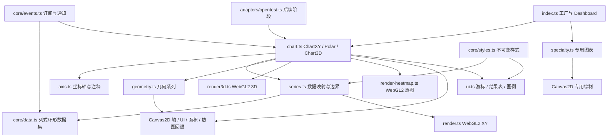

# CRYChart 当前原创架构

本说明描述当前工作目录的源码。实现采用独立列存储、显式数据所有权、按版本缓存和混合绘制管线。公开 API 外观与内部机制分离。当前逐例功能结果见 [功能验收清单](functional-verification.json)；文中带历史构建标识的计时与运行记录保留原版本边界。

## 对象与数据生命周期

`src/index.ts` 的工厂用 Set 跟踪仍存活的图表。单图销毁时立即解除工厂引用；Dashboard 同时移除子图和对应容器。统一销毁会继续处理其他图表，最后集中报告消费者回调异常。`ChartXY` 管理轴、系列、UI、多层画布、ResizeObserver、输入事件和待执行的动画帧。销毁会断开订阅、取消帧、释放绘制资源并移除 DOM。系列还会释放派生投影、颜色缓存和样条插值；这不改变共享数据集的所有权。

调用方拥有外部传入的 `DataSetXY`，系列和图表销毁不会代替调用方销毁它。系列自动创建的内部数据集则按绑定数量管理：共享到其他系列时继续存活，最后一个绑定释放时才销毁数值存储。`setDataSet` 解除旧订阅、连接新数据，并释放不再绑定的内部来源；再次绑定同一个数据集不会误销毁。内部数据需要脱离系列独立存活时，应由调用方显式创建并传入。销毁过程会继续释放其他资源，再集中报告消费者回调异常。

`core/data.ts` 分开保存物理头部、保留数量、容量和累计样本索引。普通字段使用独立 TypedArray；Float64 自动列优先保留每次输入的起点、步长和绝对样本索引，不为可计算的时间值分配整列数组。每批仍按原表达式 `start + (absoluteIndex - batchFirstIndex) * step` 求值，不能通过重定起点或合并批次改变浮点结果。支持固定上限、自动增长上限和无固定上限。追加前检查列长；超大批次只写入会被保留的尾部，但自动坐标与累计索引按整批推进。扩容先完成全部分配，再提交新状态。

`getValue` 读取保留区偏移，无需为每个点创建对象；`getSampleByIndex` 明确采用累计样本索引。`getColumn` 缓存按逻辑顺序整理的列。`getColumnSlices` 继续提供一段或两段真实 TypedArray 借用视图；若目标为隐式自动列，该调用会将它转为数组存储。渲染器改用 `getColumnRuns`，按原批次顺序读取，避免这个转换。公开 `readBack` 只复制返回区间，不先创建完整历史快照。原始非有限浮点值保留在源列；raw Y 与 render Y 不合并，绘制层负责形成缺口。

`getStorageStats` 统计数据集直接持有的数值数组、快照字节数和分段数量。它不代表整个浏览器堆、GPU 驻留内存或进程 RSS。单通道 48 kHz、60 秒容量的实际数组预分配测试中，双 Float32 Y 列占 23,040,000 字节，双 Float64 Y 列占 46,080,000 字节；该容量用例只写入了少量值，隐式 X 不占整列数组空间。这是数据层容量证据，不能据此宣称填满历史或完整 128 通道浏览器容量已经通过。

后续显式分页存储新增了独立的可见浏览器容量证据：128 通道、48 kHz、60 秒完整保留，F64 分区再推进 12 秒，F32 共享轴再推进 120 秒，均逐值核验 raw/render 两列。页级共享和写入时分离保留原存储类型；不同数据不能共享时仍独立保存。具体字节、GC 检查点和构建哈希见 [性能说明](性能说明.md)。这些容量结果不证明实时吞吐或图像等价，默认存储仍为 dense。

## XY 数据到像素

`series.ts` 管理数据列映射、系列样式、可见性、轴绑定和边界缓存。`data-bounds.ts` 按绝对样本索引划分 1024 点的固定块，完整块以单调队列维护精确极值；历史回卷时只更新新数据和被截断的首块，不逐帧扫描全部 Y 历史。数据集的 `contentEpoch` 区分连续追加与清空后重新填充，即使一帧内追加多批也不会误用旧缓存。原始数组不复制到边界缓存中。

`data-order.ts` 记录最后一个非有限点、下降边和重复边的绝对索引，逐次只检查新增区间。历史回卷后，违例只有完全离开保留范围才失效；不能仅根据 schema 的递增提示选择二分。正常隐式时间批次经过浮点间距证书后只检查端点，不确定时逐值核对。递增 X 的最近点查询使用二分；非有序输入使用线性搜索。自动 X 的边界也复用此证据，只读取保留首尾；负步长、跳变和溢出使用精确回退。

绘制数据以首个有效坐标为相对原点，在 Float64 上相减后再转 Float32，减少 epoch 等大坐标的小数精度损失。`data-runs.ts` 直接读取隐式列或借用数组；环回、跳变、负步长和对数变换已有与原数组路径逐字节一致的投影测试。

`render.ts` 优先使用 WebGL2。宽线段由实例化三角形绘制，相邻段共享接缝边界并计算解析抗锯齿覆盖率，避免把每个很短的线段都扩大成相互覆盖的端帽。点使用点图元和形状距离覆盖率。XY/Polar 默认关闭上下文 MSAA，使用解析覆盖率处理边缘。3D 继续显式启用 MSAA。非有限端点在着色器中拒绝，线不能跨越 NaN 缺口。GPU 缓冲按系列 ID 和版本缓存；纯视图变化使用 uniform，数据未变时不重复上传。

默认接缝几何在极端反折处仍有已知覆盖缺口。显式 `experimentalLineCoverage` 候选改用保守线段包围四边形，在每条线的 R8 覆盖纹理中取 MAX，再只合成一次颜色和透明度。同一源系列的分块通过 `strokeGroup` 合并，避免接缝或半透明交点重复加深。仅使用一份可增长的 ROI 临时纹理，不为每通道创建整屏纹理。

覆盖率路径在连续折线批次中只保存一次 WebGL 状态。显式 owned 选项只在私有默认目标的整帧纯覆盖率路径使用已知状态，并复用未变的固定设置。进入点、虚线、颜色线等管线前恢复，再设置主程序、VAO、完整视口和当前裁剪。正常退出先恢复状态再清理旧缓冲；异常退出由 `finally` 恢复。构建 `3a0d2147…` 的 13 项真实混合管线检查通过，默认开关仍关闭。

显示缓存 v4 保存完整页的选择结果和终止树节点拓扑。保留窗口或视区移动时，仅重新查询相交的边界节点，中间页复制已有索引和投影；拓扑内存单列为 `cachedTopologyBytes`。424 帧回绕、平移、缩放和分页数据对照中，输出源索引和 Float32 投影字节与 v3 相同。591a 在覆盖率选项启用时改用有界环形显示缓冲。普通源码构建已包含该接线，不再依赖实验打包注入。

投影缓存同时记录数据版本、样式版本、绑定版本、首个保留索引和累计下一索引。在连续追加且旧前缀未改变时，只把新增列值转换到可增长的 Float32 存储；绘制包携带更新起点和前一版本，渲染器用 `bufferSubData` 更新新增范围及接缝末端邻点。容量增长、清空、覆盖旧数据、绑定/样式改变等条件触发完整重建或上传。这个快路径不自动代表固定上限回绕也具有相同成本，回绕场景仍需独立测量。

已在 `8e8357f…` 构建的可见诊断中观察到：4 通道每次各追加 1000 点，请求上传 32,032 字节，其中包含末端邻点维护；相同输入与实际保留量逐帧核验。它证明上传增量路径生效，不能证明 GPU 已达到参考性能。真实绘制同步使用默认帧缓冲单像素读回；`gl.finish` 在 Chromium 中仅 Flush，早期调用回调耗时不能解释为 GPU 完成耗时。测量口径和限制见 [performance-matrix.json](performance-matrix.json)。当前没有用减少原始样本或降低数据规模来获得这项上传改进，帧预算与长期流式内存仍待验证。

`render-line-strip.ts` 为严格递增 X 的普通实线提供独立路径。每个样本只生成左右两个顶点，构成连续三角带。平坦插值把真实线段端点传给片元着色器。重复、反向或非有限 X，以及虚线和调色板线，继续使用通用路径。NaN-Y 仍形成缺口。缓存按追加范围更新，视区裁切只改变绘制范围。新布局每点占 16 字节，4 通道各追加 1000 点请求上传 64,064 字节。

历史构建 `6daf2c4a…` 的指定单调线、NaN-Y 与密集线画面，在本库新旧构建之间逐像素一致。完整 120 步、3 次重复的四通道原生追加中，GPU 查询中位数为 2.360 ms。该值仅对应当时构建和负载。当前性能范围见 [性能说明](性能说明.md)。

历史满环路径曾需要整段投影和上传。`line-block-cache.ts` 已实现按绝对样本索引分块的候选：原始历史继续由数据集保留，绘制缓存只持有可见块及接缝邻点；相邻块共享边界点，不重复绘制线段。它通过 `experimentalLineBlocks` 显式启用，默认关闭。局部原点仍有已记录的光栅差异，不能列为完整画质或参考性能验收成果。

`line-display-cache.ts` 是另一条默认关闭的显示候选，入口为 `experimentalLineDisplayPixels`。每个 4096 点页使用 16 点叶子的极值树；只缓存当前可见页，追加仅更新尾叶及祖先。通用选择按横向物理像素跨度保留真实首尾、最小值、最大值及必要邻点，非有限节点下降到实际断点。对有限 dense Y、严格均匀自动 X、不透明 2px 普通实线且轴未反转的已证明路径，每桶按原顺序提交双极值，并保留页面、视口边界和邻接桥点。选择与 Float32 投影按页复用；请求变化的边缘页重新选择，未变完整页可复用自有选择和投影。完整 DataSet、读回、边界与游标仍使用原始精度和全部保留样本。

显示候选统计分别列出原始保留量、实际提交量、摘要、索引选择及投影数组的容量。两个缓存均直接读取 dense、affine 或 paged 借用视图，不把隐式 X 或分页列物化成完整历史数组。数据集的 content epoch、绑定和坐标转换改变会失效缓存；隐藏会释放显示派生数组与位置 buffer，并保留数值原点及失效元数据供同源恢复。清空、重绑、回退和销毁仍清理对应状态。既有尖峰、断线和半透明覆盖检查按各构建记录；它们不等于完整参考抗锯齿或图像等价，详见性能说明。

`core/line-delta-certificate.ts` 记录数据生产世代、追加范围与前缀淘汰。`line-selection-ledger.ts` 仅在证书证明旧页及邻点未变时复用自有页，不跨变更保存借用 reader。祖先合并和范围聚合保持原浮点运算与左右顺序，减少临时数组；不满足条件时使用完整原路径。

`line-display-arena.ts` 按稳定页选择维护有界连续环形缓冲，记录实际修改区间。绘制包共享 storage ID，并携带 arena 起点。`render-line-coverage.ts` 在容量增长或版本断链时完整上传，否则仅上传变更范围；同一 storage 的多个包复用一个 GPU buffer。原始列、原始精度和读回保持完整。

`viewport.visibleSourceSegments` 在原 strict/finite 检查后读取保留首尾。已覆盖的端点直接复用，内侧范围仍用原二分和 padding 规则。`raster-clip.ts` 的显式 contained 策略约束完整物理像素；默认仍沿用 legacy，未把裁剪变化当作参考画质等价。四项选项和适用范围见[使用手册](使用手册.md#显式波形优化选项)。

Canvas2D 叠加层绘制轴、文字、注释、游标、图例、面积和几何系列。当前已新增 `render-heatmap.ts`，适用网格热图通过 GPU 纹理与调色板绘制，并与 XY 后端共享清屏顺序；不适用的热图继续使用按版本缓存的 ImageData/离屏画布路径。新增管线的真实像素、缺值与颜色检查必须有自己的运行证据，不能把 XY 线条结果外推为百万格热图性能。

热图保留待上传区域及最早的前置版本。同一帧的多次小更新合并为包围矩形，完整更新一直保留到上传确认；隐藏图和丢失的 GPU 上下文不会提前确认。可见 Chrome 的 11 组完整 RGBA 对比均无差异，双列更新上传量由 1,000,000 字节降到 8,000 字节，另有实际 ChartXY 接线与上下文恢复检查。

`heatmap-stream.ts` 为 OpenTest 频谱实现绝对 `iSample` 写入。跳号重复最后一列，先写 NaN 后跳号会形成透明缺口。`resolution` 只规定非滚动维，滚动维按需增长；`minDataPointCount` 保留最低数量且只清理移出视野的旧样本，`maxDataPointCount` 才是硬上限。实际数据边界与纹理分配边界分开，未使用的格子保持 NaN。显式 `columns`/`rows` 固定环形容量是 CRYChart 保留的扩展用法。

## 3D 路径及其证据边界

早期 3D 使用 Canvas2D CPU 投影。当前源码已增加 `render3d.ts` 和 `Chart3D.renderData`：坐标归一化后送入 GPU，旋转和缩放通过相机 uniform，绘制线、点和三角曲面，使用深度测试。曲面三角形若包含无效顶点则整组三角形移除；位置与颜色同步整理。相机转动与数据上传分开，避免仅旋转相机便重传数据。

当前默认使用独立实现的 world/XYZ 相机，支持透视与正交投影及自动适配。`world-axis.ts` 在轴区间、对数/反向坐标和几何 margin 之间转换；`world-camera.ts` 管理 world 比例、相机局部基、适配、近平面与屏幕投影。CPU轴、Canvas回退与GPU共用相机帧。显式角度相机调用保留legacy模型，不能混用两类位置对象。透明物体排序、拾取和完整参考相机行为仍需逐例核对。

`setBoundingBox` 改变三维数据盒的相对长宽高，CPU轴投影与GPU位置采用同一比例。world帧按viewport、plot、boundingBox、位置、投影和自动适配状态缓存。视图变化通过相机参数更新；源数据与相机状态分开。完整参考画面一致性仍需单独验证。

`zoom-clock.ts` 在现有requestAnimationFrame调度中处理world滚轮输入。渐进动画与关闭动画时的输入分别保持有界状态，同帧输入先聚合，再应用最终范围限制。隐藏、销毁和模型切换清理待处理状态。公开动画开关和旧角度模型有独立回归，新增功能不继承591a的正式计时结论。

新增源码和成功构建本身不构成 GPU 3D 验收。必须以新增后的可见 Chrome 图形检查和 GPU 资源统计为证据；早期 3D Canvas 截图不能证明新后端正确。`getRenderStats` 的后端字段亦不能代替真正的数据像素与深度遮挡检查。三维持续负载需要单独测量。

## 轴、UI 和其他图表

`axis.ts` 保存区间、停止/自动 fit 状态、刻度策略、方向和位置等配置，负责坐标与绘图区比例互转。固定轴不能随新数据被自动重置。常量线、Band 和自定义刻度依附轴，输入事件须区分绘图区、轴区和 UI 命中。

OpenTest 的堆叠波形在一个 ChartXY 内使用 `iStack: -index`。`axis-layout.ts` 将每个 `iParallel` 与 `opposite` 组合独立分区；0 在上，负索引向下，默认等高。这个方向和独立分组已通过原版 5.2.1 的公开 API 实际运行确认。CRYChart 的 128 分区、相对/像素长度、对数反向坐标和客户端坐标转换已有单元测试；可见 Chrome 专项验收另行记录。分区复用一个 WebGL 上下文，使用独立数据域和裁剪矩形，不能用 128 个画布替代这一要求。

原版 8.2.0 的公开运行探针也已确认分区方向及 `setUnits`：轴标题和内置光标结果表分别受 `displayOnAxis` 与 `displayInCursor` 控制，每次省略选项均恢复默认显示。`getTitle` 不拼单位，`formatValue` 与轴边光标刻度也不拼单位。Polar 径向轴的 `setNorth` 使用角度，刻度格式函数接收弧度，数据点的 `angle` 继续使用角度。

`ui.ts` 提供 Canvas UI、结果表、游标、图例的绘制及命中；`core/events.ts` 负责订阅令牌与解除；`core/styles.ts` 提供 Color、Fill、Line、Font、LUT 等独立样式值对象。样式 setter 返回新值，不能污染共享样式。公开颜色通道与 GPU 归一化数值在边界转换。

`geometry.ts` 提供矩形、多边形、线段、范围、OHLC、箱线几何系列，当前走 Canvas 绘制和自身命中。`specialty.ts` 实现饼图、仪表、雷达、柱图、树图、平行坐标和数据表；各自管理 Canvas、重绘和输入清理。每个场景需要分别检查图形、数据、交互和生命周期。

真实 Chrome 检查曾发现：把十万个矩形合成一个路径会导致约 48 秒卡顿和图形上下文丢失。当前矩形路径限制每批最多 256 个，完整数据数量保持不变。在历史构建 `dd8884c9…` 上，实际浏览器的同类绘制动作加两帧等待耗时 179.8 ms，三个画布上下文均未丢失。随后 `9804ca3f…` 的重点图表检查也验证了十万柱中段放大和实际鼠标命中。这些结果只证明当时构建的自身故障修复。

## 兼容层与验证隔离

`src/adapters/opentest.ts` 不依赖 Vue，将 FrameworkChartApi 的数据帧、视口和导出请求转换为 CRYChart 调用。它先校验数据，区分 xy/uniform 与 append/replace，种类变化时重建系列，保留原始数组，处理显示缺口。浏览器导出异步返回 Blob；桌面保存行为由宿主接入。

`opentest-vite-alias.mjs`、消费者 Vitest 配置和 runner 用于独立消费检查。默认单元测试排除 `opentest*.test.ts`，消费合同通过单独命令检查。OpenTest 保持只读。本库中的归一化消费需求记录于 `opentest-contract.json`，不能用这份清单证明应用替包或完整工作流已经通过。

构建输出 ESM、CommonJS、IIFE 与类型声明。参考运行字节保留在开发工作区和实验室中，用于运行对照和经用户授权的实现研究。最终交付不包含这些字节，构建入口只取原创 `src` 和 `examples`。最终发布仍需检查发行包内容与声明覆盖。

## 本轮功能修复

散点曲面的三角剖分从真实点的凸包开始，逐点加入外侧面，再按空圆条件翻转共享边。方向和圆内判断使用原始 IEEE 754 输入的精确整数表达，避免全局归一化让局部共线或共圆点产生错误符号。存储只保留当前有效三角面，翻边时删除旧面，避免累计保留中间历史。该实现有二次复杂度的最坏情况；800 点示例的结果不能外推为百万散点曲面的性能成绩。

专用图表的悬浮状态保存命中结果的副本。下一次命中测试可更新临时对象，而不会改写正在显示的提示。此修复覆盖平行坐标中小数位置移动后按整数像素点击的情况。

极坐标热图在重绘和尺寸变化后，根据保存的实际鼠标位置重新计算提示值。鼠标离开后清除提示，销毁时解除订阅。示例中的图片拖动、边界注释、统计值与生命周期也需要专项检查。

## 验证边界

本地目录收录 167 个功能场景。扩展图形时保持数据集所有权、非有限值处理、版本缓存和事件解除的一致性。历史本库结果与当前源码验收分别记录。长期稳定性、数据精度、交互和应用集成需要分别验收。

仍需核对所有返回类型和事件载荷，补齐版本间接口差异，完成热图、3D、专用图表的性能管线，并验证多图共存、上下文丢失恢复、长期运行内存和完整导出行为。以上缺口不会因已有局部测试通过而自动关闭。

## 消费交互修复的边界

`component-highlight.ts` 保存高亮强度和有界动画状态，通过现有帧调度更新显示颜色。系列原始值与用户样式保持；图表级动画开关传递给已有与随后创建的系列。隐藏、清空和销毁清理待绘制状态。world3D仍将全局开关连接到既有滚轮动画。

Axis 的 `setAnimationScroll(true)` 对自动区间启用有界的时间响应；`false/undefined` 立即滚动。Chart 只保存正在滚动的轴，复用现有动画帧调度。显式区间、停止、隐藏、清空或销毁会取消动画。真实 Chrome 已检查中间帧和最终位置；不承诺参考库的缓动曲线或时长。限制 getter 独立读取配置或解析回调。仅 XY 线性轴的有限正数对象 `intervalMax` 进入约束：手动提交保持请求中点；wheel 先限比例再生成锚定区间。Setter 延后生效，其他限制、回调执行、对数、Polar 和 3D 约束保持本次范围外。
